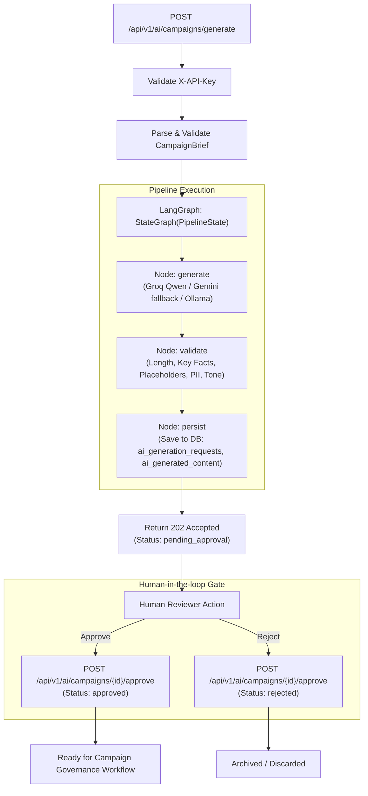

# AI Campaign Assistant Workflow

The AI Campaign Assistant generates, validates, and stores draft campaign messages based on a structured brief.

> [!IMPORTANT]
> **Strict Publication Guard:** The AI **never** publishes messages or triggers distribution. Every draft is stored with status `pending_approval` and requires explicit human review and approval.

## LangGraph Pipeline Architecture

## State Transitions

- **pending_approval**: Draft has been generated and validated, waiting for reviewer action.
- **approved**: Reviewer has explicitly approved the draft. It may now be incorporated into standard campaign templates.
- **rejected**: Reviewer rejected the draft with feedback notes. Cannot be re-approved.
