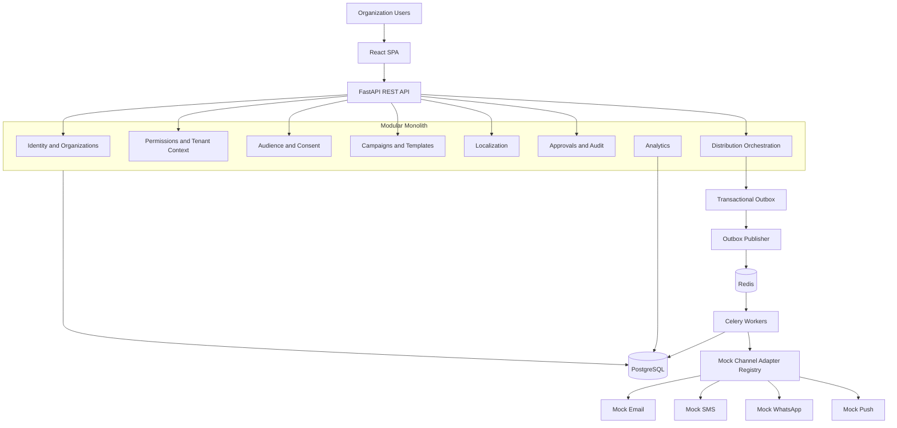

# SandeshVani — System Architecture v2

**Version:** 2.0  
**Status:** Proposed architecture baseline; detailed design decisions remain open where identified in the RTM.

## 1. Architectural decision

Use a **modular monolith**: one FastAPI application with separately run Celery worker processes, a shared PostgreSQL database and Redis as broker/cache. Keep module boundaries explicit. Do not introduce microservices, Kafka or Kubernetes for the MVP.

## 2. Architecture goals

- Strong tenant isolation and organization-scoped multiple-role RBAC.
- Governed audience, consent, campaign and approval workflows.
- Versioned English/Hindi content with an extensible Indic language registry.
- Four-channel mock distribution with no live provider path in R1.
- Durable, idempotent asynchronous processing and auditable state.
- Design target of 100,000 recipients per campaign, verified through load testing.

## 3. Logical architecture

## 4. Technology baseline

Frontend: React, JavaScript, Vite, Tailwind CSS, DaisyUI, React Router, Axios, Lucide React, Recharts, React Hook Form and Zod.  
Backend: Python, FastAPI, Pydantic, SQLAlchemy 2.x, Alembic, pytest and HTTPX.  
Data/async: PostgreSQL, Celery and Redis.  
Local infrastructure: Docker Compose.  
Operations: structured logs and request IDs initially; Sentry and Prometheus/Grafana/OpenTelemetry may be introduced progressively.

## 5. Backend modules

`identity`, `organizations`, `permissions`, `audiences`, `consent`, `campaigns`, `templates`, `localization`, `approvals`, `distribution`, `providers`, `analytics`, `audit`, and later `ai_engine`.

Modules own their business logic and repositories. Cross-module collaboration uses explicit application interfaces/domain events, not arbitrary imports of private internals. Keep provider adapter implementations behind a stable interface.

## 6. Request and tenant flow

Browser → FastAPI → authenticate session → resolve requested/active organization through membership → aggregate assigned role permissions → authorize resource and workflow state → tenant-scoped service/repository → PostgreSQL under RLS.

The client-supplied organization ID is a selector, not proof of access. Every request verifies active membership. Set transaction-local tenant context before tenant queries. Use an application database role that is not table owner and lacks `BYPASSRLS`.

## 7. Major data flows

**CSV import:** upload validation → controlled file storage + import job + outbox → bounded worker chunks → normalized rows/row errors → UI progress.  
**Campaign approval:** draft → immutable version and content hash → submit → reviewer inspects exact snapshot → decision → audit.  
**Mock execution:** approved version → eligibility recheck → recipient snapshot → channel delivery intents + outbox rows in one transaction → publisher → Celery → mock adapter → attempt/status persistence → analytics.

## 8. Multiple-role authorization

A membership may map to multiple roles through `membership_roles`. Effective permissions are the union of permissions assigned to those roles, subject to explicit deny/constraint policies if adopted. Role grants are validated against the grantor's authority. Roles are organization-scoped except explicitly controlled platform roles. Revocation must affect subsequent authorization checks.

## 9. Distribution architecture

Use a provider-independent adapter contract with validation, capability declaration and send simulation. R1 adapters: mock Email, SMS, WhatsApp and Push. Adapter responses simulate accepted, delivered, failed, retryable and unknown outcomes. The MVP must not include production provider SDKs, credentials, endpoints or a configuration flag capable of enabling live dispatch.

PostgreSQL is authoritative. Create logical delivery intents and outbox events in the same transaction. Redis/Celery may deliver tasks more than once; consumers must be idempotent. Use bounded batches, worker concurrency/rate controls, retries with jitter, dead-letter/exhausted-work handling and explicit unknown-outcome handling.

## 10. 100k recipient strategy

Do not enqueue one task containing the entire audience. Build recipient snapshots and delivery intents in bounded database batches; publish bounded outbox batches; process bounded worker tasks; use indexes aligned to status/tenant/campaign access patterns; avoid per-recipient unbounded fan-out in API requests. The actual throughput and completion-time objective are OPEN and must be measured under a documented workload profile.

## 11. State models

Campaign states proposed: `DRAFT`, `SUBMITTED`, `APPROVED`, `SCHEDULED`, `PROCESSING`, `PAUSED`, `COMPLETED`, `REJECTED`, `CANCELLED`, `FAILED`. Valid transitions are backend-owned. The relationship between approval and scheduling must be finalized before implementing scheduled execution.

Delivery states: `PENDING`, `PROCESSING`, `ACCEPTED`, `DELIVERED`, `RETRY_WAIT`, `FAILED`, `UNKNOWN`, `CANCELLED`. Acceptance is not delivery confirmation. Attempts are separate records.

## 12. Localization

Store language tags and language metadata in a registry. English and Hindi are initial supported content languages. The system should allow additional Indic language records without schema changes. Each campaign version has explicit language-specific content variants and review status. Do not claim full localization quality or complete language coverage from registry extensibility alone.

## 13. Security and operational requirements

See `../security/THREAT_MODEL.md`. Critical controls include RLS, tenant-safe composite FKs, least privilege, secure sessions, safe uploads/exports, immutable approved versions, server-enforced mock-only dispatch, transactional outbox, idempotency, replay protection for future webhooks, secret management, backup/restore and observability.

## 14. Explicitly deferred

Microservices, Kubernetes, Kafka, multi-region active-active, advanced ML targeting, AI agents, production analytics warehouse, vector database and live providers in R1. Add only after a measurable requirement and architecture decision record.

## 15. Architecture status

This is a logical architecture baseline. It is not yet a frozen physical schema or production deployment design. Finalize ERD, constraints, exact state transitions, API schemas, tenant/RLS policy, performance profile and operational objectives before implementation is treated as ready.
